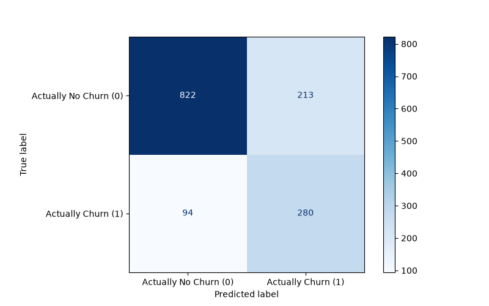
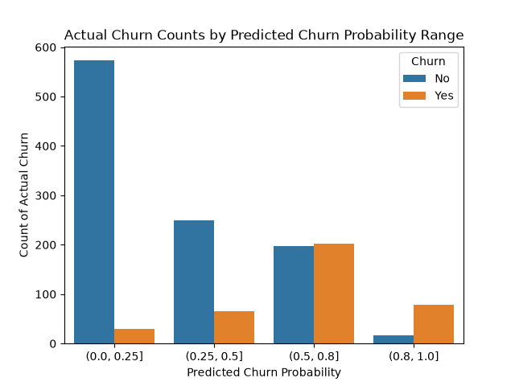

# 🔎 ChurnLens

ChurnLens is a Streamlit app that predicts whether a telecom customer is likely to churn. It supports predictions for one customer or a batch of customers uploaded as a CSV.

The model was trained on the [Telco Customer Churn dataset](https://www.kaggle.com/datasets/blastchar/telco-customer-churn).

## Features

- **Single prediction:** Enter a customer's information to see a churn label, predicted probability, and risk level.
- **Batch prediction:** Upload a CSV, view predictions for each customer, and download the results.
- **Model comparison:** Compare Logistic Regression, Random Forest, and XGBoost using randomized hyperparameter search and 5-fold cross-validation.

## Setup

Requires Python 3.15. From the project root:

```bash
python3 -m venv .venv
source .venv/bin/activate
pip install -r requirements.txt
```

## Run the app

```bash
streamlit run app.py
```

Use **Single Customer Prediction** to enter one customer, or **Batch Predictions** to upload a CSV. The app provides a sample CSV with the required columns and value formats.

For CSV uploads:

1. Include every required feature column shown in the sample CSV.
2. Use the same category names shown in the single-customer form.
3. If `InternetService` is `No`, set internet-related features to `No internet service`.
4. If `PhoneService` is `No`, set `MultipleLines` to `No phone service`.
5. Enter `SeniorCitizen` as `Yes`/`No` or `1`/`0`.
6. Use plain numbers for numeric fields, without blanks or currency symbols.

## Model comparison

I tuned three classifiers with 5-fold cross-validation and selected the model with the highest cross-validated F1 score.

| Model | Best CV F1 | Test F1 (Churn) | Test ROC-AUC |
|---|---:|---:|---:|
| Logistic Regression | 0.6227 | 0.6008 | 0.8296 |
| Random Forest | 0.6287 | 0.6246 | 0.8361 |
| **XGBoost** | **0.6331** | **0.6459** | **0.8461** |

XGBoost had the highest cross-validated F1 score in this comparison, so it is the model used in the app. ROC-AUC measures how well the model ranks churners above non-churners; it does not change the app’s 50% cutoff.

## Test results

At the 50% cutoff, XGBoost was evaluated on a held-out test set of 1,409 customers:

- It correctly identified **280 of 374** customers who churned (**74.9% recall**).
- Of the **493** customers it flagged as likely to churn, **280** actually churned (**56.8% precision**).
- It missed **94** churners and incorrectly flagged **213** customers who did not churn.



## How predictions work

The app labels a customer **Churn** when the predicted churn probability is **50% or higher**. Below 50%, it labels the customer **No Churn**.

Risk levels describe ranges of the same predicted probability:

| Risk level | Predicted churn probability |
|---|---:|
| Low | 25% or less |
| Moderate | Above 25% to below 50% |
| Elevated | 50% to 80% |
| High | Above 80% |



Risk levels are labels derived from the model’s output on a test set, not predictions from a separate model.
See more details at [eda.ipynb](notebooks/eda.ipynb)

## Project structure

```text
.
├── app.py                    # Streamlit app
├── app_predict_process.py    # Prediction and risk-label helpers
├── app_utils.py              # UI and CSV validation helpers
├── requirements.txt          # Python dependencies
├── assets/
│   └── confusion_matrix.png  # Test-set confusion matrix
├── data/
│   └── raw/                  # Telco Customer Churn CSV
├── model/                    # Saved model and preprocessing artifacts
├── notebooks/
│   └── eda.ipynb             # Exploratory data analysis
└── src/
    ├── preprocess.py         # Data cleaning and preprocessing
    ├── train.py              # Model training and comparison
    └── confusion_matrix.py   # Confusion matrix plot
```

## Retrain the model

To reproduce the training process, place `WA_Fn-UseC_-Telco-Customer-Churn.csv` in `data/raw/`, then run:

```bash
cd src
python train.py
```

The script cleans and splits the data, fits the preprocessing transformer, and tunes Logistic Regression, Random Forest, and XGBoost using randomized search with 5-fold cross-validation. It selects the model with the highest cross-validated F1 score and saves the selected model (model.joblib) and fitted transformer (transformer.joblib) in `model/`.

For each classifier, the terminal shows its best CV F1 score, test ROC-AUC, best parameters, and test classification report. **Retraining replaces the saved model artifacts**, so the app will use the newly selected model afterward.

To generate a confusion matrix from the saved test predictions, run from the project root:

```bash
python src/confusion_matrix.py
```

## Limitations

Predictions are estimates based on patterns in the training data. At the 50% cutoff, the model can miss customers who churn and flag customers who stay, as shown in the test results.